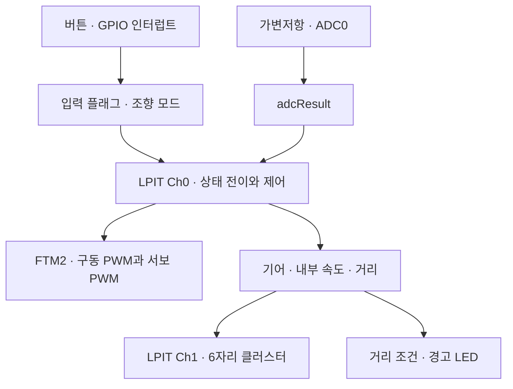

# S32K144 기반 교육용 차량 전장 제어 시스템

**주행 제어와 클러스터 표시를 하나의 MCU에 통합한 Embedded C 프로젝트입니다.** 서로 다른 실행 주기의 기능을 LPIT 채널로 나누고, GPIO·ADC·PWM·상태 제어를 연결했습니다.

| 핵심 | 내용 |
| --- | --- |
| 목적 | 교육용 차량의 상태·가감속·조향·표시 기능을 하나의 MCU에서 연동 |
| 본인 기여 | **클러스터·연료 경고등 직접 구현**, 이후 가속 제어 로직 개발·시스템 통합 참여 |
| 핵심 구현 | LPIT 제어/표시 주기 분리, ADC 기반 속도 상한과 PWM 출력, 상태별 동작, 6자리 표시 |
| 검증 결과 | **실물 보드의 클러스터 D/R 표시·모터 변수 연동·경고 기능 기록 확보.** 당시 시험 펌웨어와 현재 공개 소스의 버전 동일성은 미확인 |
| 기술 | NXP S32K144 · C · GPIO ISR · LPIT · ADC0 · FTM2 |

속도·거리와 연료 경고는 내부 변수를 이용한 교육용 모사입니다. 실제 차량 센서 측정이나 전력 구동 회로 설계 경험으로 제시하지 않습니다.

## 구현과 담당 범위

| 구분 | 구현 내용 | 코드 |
| --- | --- | --- |
| 직접 담당 | 기어 1자리·속도 3자리·거리 2자리 순차 표시 | [seven_segment.c](seven_segment.c) |
| 직접 담당 | 내부 거리 조건에 따른 연료 경고 LED | [motor.c](motor.c)의 `Fuel_Warning()` |
| 개발 참여 | ADC 입력에 따른 속도 상한·가속·PWM 갱신 | [motor.c](motor.c)의 `DRV_Control()` |
| 통합 참여 | 공유 변수와 기능 인터페이스 연결, 제어·표시 처리 통합 | [lpit.c](lpit.c), [common.h](common.h) |
| 팀 결과 | OFF/P/D/R/CRUISE 상태별 로직, 제동·조향·방향 LED | [state.c](state.c), [turn.c](turn.c) |

담당 범위는 참여자 설명에 근거하며 전체 통합 소스를 단독 구현한 것으로 표시하지 않습니다.

## 시스템 구조

제어와 표시를 다른 타이머 채널에 배정했습니다. 실제 호출 순서·핀맵·주기 계산·현재 FSM 전이는 [아키텍처](docs/architecture.md)에서 확인할 수 있습니다.

## 설계 판단과 검증 근거

표시 스캔과 제어 로직의 갱신 주기를 분리하고, 기능별 입력과 공통 상태를 연결했습니다. **개인 최종 보고서에는 실제 보드에서 D/R 표시 전환·모터 변수 연동을 확인하고 표시 주기를 0.5ms에서 2ms로 조정한 과정이 기록돼 있습니다.** 공개 소스의 Ch1 명목 0.05ms와는 별도 버전이며 지터·PWM 정확도는 측정하지 않았습니다. [실물 보드 검증 이력](docs/board-validation-evidence.md)에서 구분합니다.

| 기술 문서 | 내용 |
| --- | --- |
| [아키텍처](docs/architecture.md) | 핀맵·LPIT 실행 순서·ADC→PWM·현재 FSM |
| [구현 및 통합](docs/implementation.md) | 클러스터·경고등·가속·자원 공유와 설계 판단 |
| [빌드 환경](docs/setup.md) | 필요한 개발 파일과 재현 준비 |
| [검증과 한계](docs/validation.md) | 공개 소스 정적 분석·미해결 코드 사항 |
| [실물 보드 시험 기록](docs/board-validation-evidence.md) | 원본 보고서의 D/R 표시·주기 튜닝과 공개 소스 버전 구분 |
| [수정·검증 계획](docs/remediation.md) | 코드 결함 우선순위와 향후 통과 기준 |

문서 기준 소스: [`0dde981`](https://github.com/YeongSu-Lim/Microprocess-Design/tree/0dde981c3934d60a727740ee7f39a67544625d43). 현재 소스의 재현 조건과 미해결 사항은 상세 문서에 보존했습니다.
