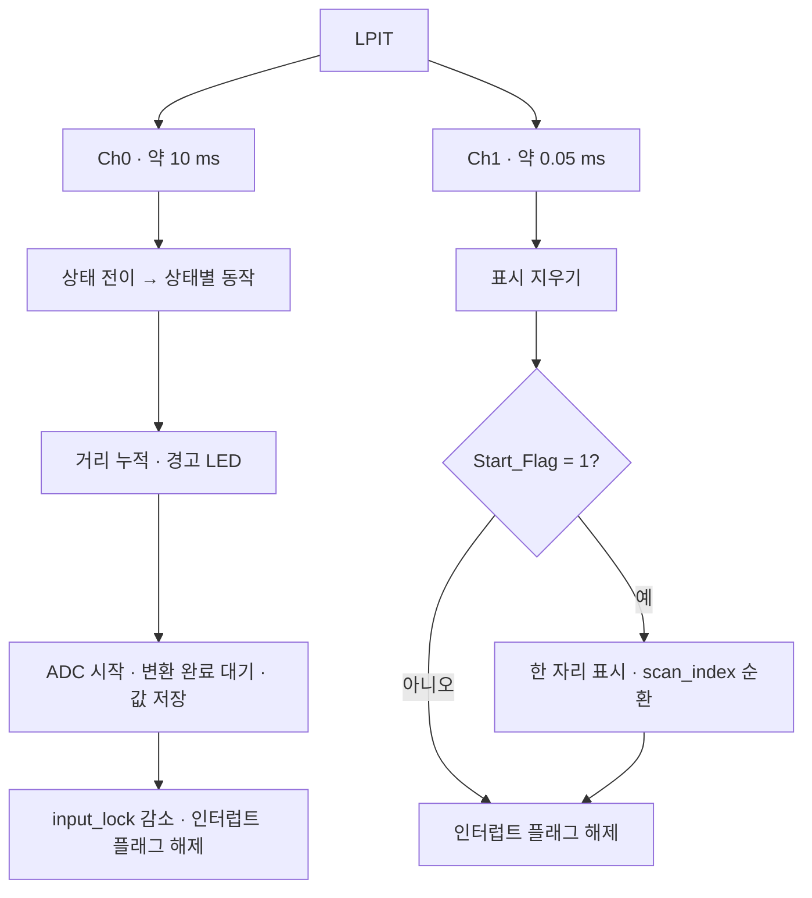
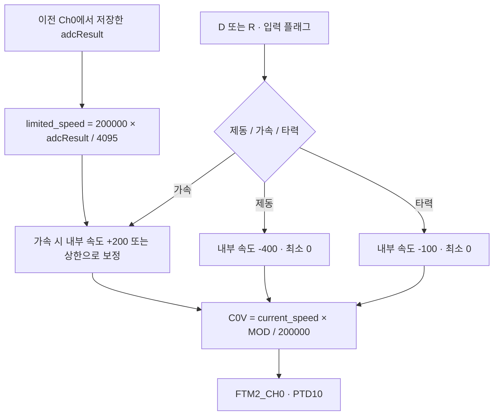
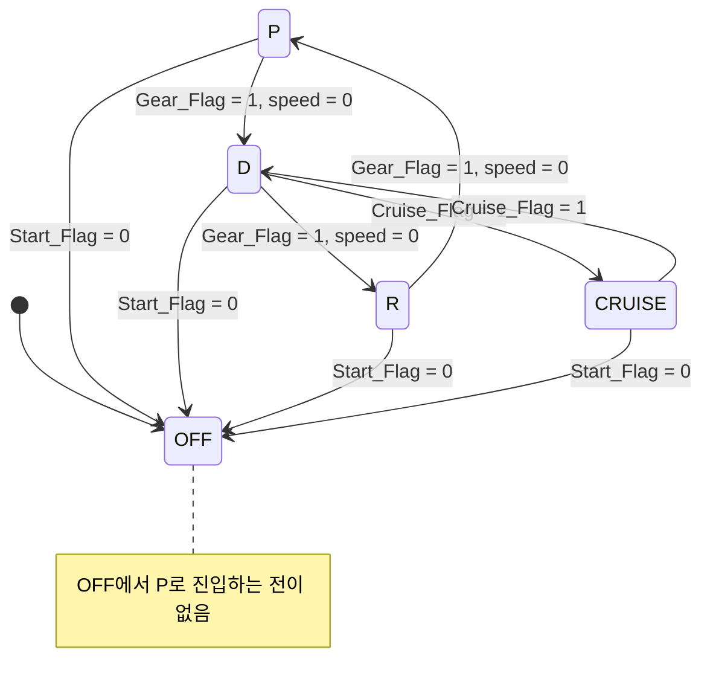

# 아키텍처 · 핀맵 · 실행 주기

[README로 이동](../README.md)

현재 소스의 연결 구조를 설명합니다. 회로도·보드 배선·측정 파형을 대체하지 않습니다.

## 자원과 핀 할당

| 기능 | MCU 자원 / 핀 | 설정·사용 위치 |
| --- | --- | --- |
| 시동 / 기어 | PTA13 / PTA12 | `PORT_init_Motor()`, PORTA ISR |
| 크루즈 / 제동 / 가속 | PTC15 / PTC16 / PTC17 | `PORT_init_Motor()`, PORTC ISR |
| 조향 모드 | PTC13 / PTC12 | `PORT_init_turn()`, PORTC ISR |
| 속도 상한 입력 | PTB0 · ADC0_SE4 · 12비트 | `ADC0_init()`, `adc_start()` |
| 구동 PWM | PTD10 · FTM2_CH0 | `FTM2_CH0_PWM()` |
| 서보 PWM | PTD11 · FTM2_CH1 | `FTM2_CH1_PWM()` |
| 자리 선택 | PTB8~PTB13 | `PORT_init_Segment()` |
| 세그먼트 a~g | PTD8, 9, 12, 5, 13, 14, 3 | `seven_segment.c` 출력 마스크 |
| 방향·제동 표시 | PTE14–PTE16 · PTA0–PTA1 | `Led_blink()` |
| 연료 경고 모사 | PTD15 · active-low | `Fuel_Warning()` |

근거: [motor.c](../motor.c), [turn.c](../turn.c), [seven_segment.c](../seven_segment.c), [handler.c](../handler.c), [regs_config.h](../regs_config.h). 조향과 LED의 좌우 주석이 일부 일치하지 않아 물리적 좌우는 배선 확인이 필요합니다.

## LPIT 실행 구조

| 채널 | TVAL | 코드의 40 MHz 입력 기준 | 처리 내용 |
| --- | --- | --- | --- |
| Ch0 | 400000 | 약 10 ms · 100 Hz | 상태 전이→상태별 동작→거리→경고→ADC→입력 잠금 감소 |
| Ch1 | 2000 | 약 0.05 ms · 20 kHz | 표시 초기화→시동 ON이면 한 자리 스캔 |

설정: [handler.c](../handler.c) `LPIT0_init()`. 클럭 초기화: [clocks_and_modes.c](../clocks_and_modes.c). 위 주기는 코드와 주석의 명목값이며 계측 결과가 아닙니다. 6자리 전체 스캔은 ISR 지연이 없다고 가정하면 약 0.3 ms입니다.

별도 RTOS는 없습니다. `main()`은 초기화 후 빈 루프를 실행합니다. ADC 완료를 ISR 안에서 기다리며, NVIC 설정에서 Ch1 구간도 `NVIC_IPR48`에 기록하므로 실행 시간·우선순위·지터를 추가 확인해야 합니다. 채널 분리만으로 무간섭을 입증하지 않습니다.

## ADC → 속도 상한 → PWM

가속 분기에서만 속도 상한을 다시 계산합니다. `current_speed <= limited_speed`이면 먼저 200을 더하므로 한 번의 업데이트에서 상한을 넘을 수 있습니다. CRUISE는 속도 변수에 대응하는 PWM을 유지하며 ADC 상한을 재적용하지 않습니다. 속도 피드백 센서가 있는 폐루프 제어는 아닙니다.

FTM2 CH0/CH1은 코드상 8 MHz 입력과 /4 분주, `MOD=39999`로 약 50 Hz를 의도합니다. 두 채널이 타이머 주기를 공유합니다. 실측 주파수·듀티 정확도·모터 드라이버 회로는 미확인입니다.

## 현재 코드의 FSM

기어·크루즈 전이는 `Start_Flag == 1`인 분기 안에서만 평가합니다. 초기 OFF에서 출발하는 경로가 없으므로 위 P/D/R/CRUISE 로직의 존재와 리셋 후 도달 가능성을 구분해야 합니다. D에서 기어·크루즈 플래그가 동시에 들어오면 기어 전이를 먼저 실행합니다. R 상태는 D와 같은 PWM 함수를 호출하며 역회전 제어가 별도로 구현되어 있지 않습니다.
